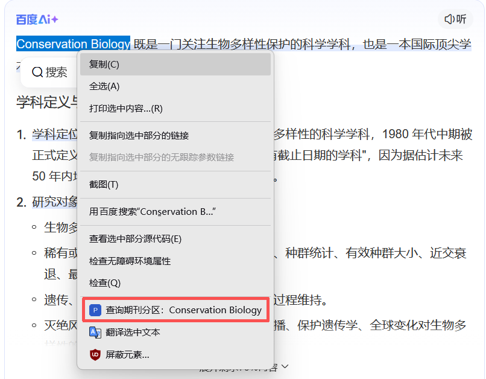
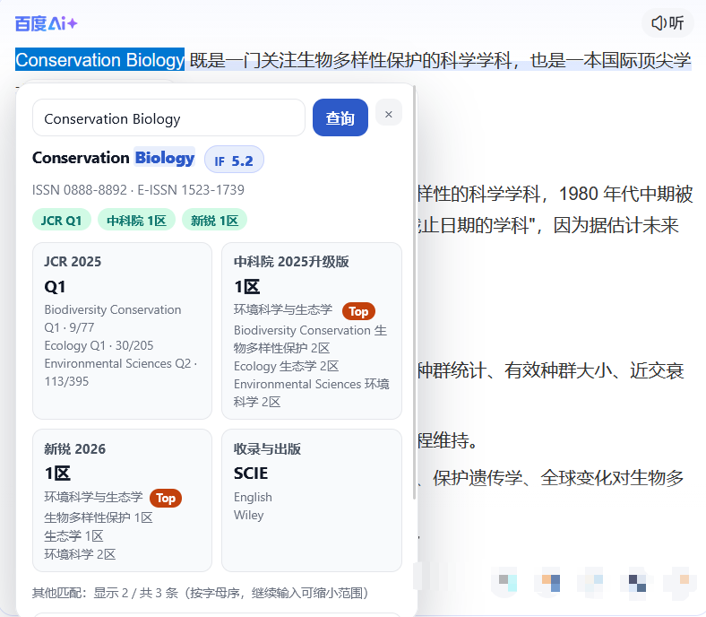
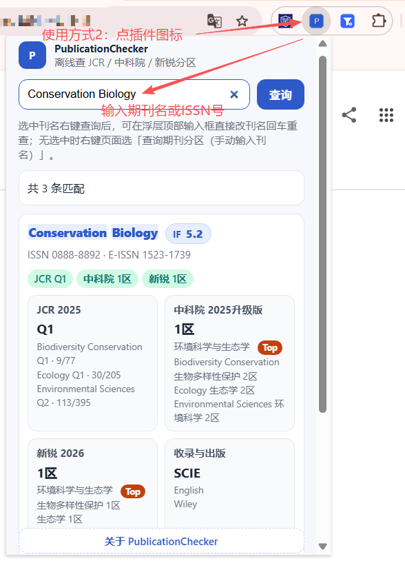

# PublicationChecker · 期刊分区查询

在网页上选中一个期刊名，**点右键 → 「查询期刊分区」**，结果就直接弹在当前页面上。

不用切标签页，不用打开查询网站，不用登录，不用联网。

<!-- 截图位 1（头图）：把下面这行取消注释，并把图放到 docs/images/ 后一起提交

-->

内置 **23059 本期刊**的分区数据，装完就能查。整个扩展只有 2.3 MB，比一张手机照片还小。

| 能查到 | 版本 |
|--------|------|
| JCR 分区（含影响因子、学科四分位） | 2025 |
| 中科院分区（大类 / 小类 / Top） | 2025 升级版 |
| 新锐分区 | 2026 |

这份说明分两部分：**第一部分给普通用户**，讲插件能做什么、怎么装、怎么用；**第二部分给进阶用户**，讲怎么更换内置的期刊数据库。大多数人只需要看第一部分。

---

# 第一部分 · 普通用户

## 它解决什么麻烦

看文献列表、读审稿意见、挑投稿目标的时候，经常要核对某本期刊是几区、影响因子多少。平时的做法是：复制刊名 → 新开一个标签 → 打开分区查询网站 → 粘贴搜索 → 有的还要登录 → 查完再切回来。

这个扩展把这一串压成一步：**选中刊名，右键，看结果**。查完点一下页面别处就收起来，你原来在读的东西一点没动。

结果卡片只展示信息，**不放任何外链** —— 不会顺手把你带去别的网站。

## 怎么用

有两种用法，任选其一。

### 用法一：选中刊名 → 右键（最常用）

1. 在任意网页（http/https）上选中一个期刊名
2. 右键 →「查询期刊分区：xxx」
3. 结果弹在选中的地方，点页面别处即收起





### 用法二：点工具栏图标 → 直接输入

没有现成刊名、或者想直接搜？点浏览器工具栏上的扩展图标，在弹窗里输入期刊名或 ISSN 号，回车即查。



## 结果卡片里有什么

- **刊名** + ISSN / E-ISSN
- **JCR 分区**、学科四分位，以及一个淡蓝色的**影响因子**标签
- **中科院分区**（大类 / 小类，Top 刊另有标记）
- **新锐分区**
- 收录情况（WOS 的 SCIE / ESCI 等）、是否综述刊、语种、出版机构、中文名

## 几个让查询更准的小技巧

- **尽量选中完整的英文刊名**（比如 `Applied Computing and Informatics`），这样最准。
- **只选中了一部分也没关系**，扩展会把相关的候选都列出来，你自己点一个。界面会告诉你一共命中多少条（比如「共 92 条匹配，按字母序显示前 8 条 —— 继续输入可缩小范围」），多打几个字母就能快速缩到你要的那本。
- **识别不准就直接改**：卡片顶部有个输入框，你选中的内容已经自动填进去了，**边打字边出结果**，按回车或点「查询」立即重查。
- 候选列表底部有「**继续查看**」，每点一次多显示 10 条。
- **也支持用 ISSN 查**，比刊名更精确。
- 选中文字本身不会被干扰（方便你正常复制粘贴），只有主动点右键菜单才会触发查询。

## 安装

> **Chrome / Edge 不能直接导入 ZIP。** 请先解压成一个文件夹，再加载那个文件夹。

到 [Releases](../../releases) 页面下载对应你浏览器的文件（两个文件名是固定的、不带版本号，以后发新版还是这两个名字）：

**Chrome / Edge** —— 下载 `PublicationChecker-chrome.zip`

1. 解压 zip，得到一个文件夹
2. 打开 `chrome://extensions`（Edge 是 `edge://extensions`）
3. 右上角开启「开发者模式」
4. 点「加载已解压的扩展程序」→ 选择刚解压出来的文件夹（要选到含 `manifest.json` 的那一层）

**Firefox / Zen** —— 在 [addons.mozilla.org](https://addons.mozilla.org/) 搜「PublicationChecker」安装，之后浏览器会自动更新。也可以从 [Releases](../../releases) 下 `PublicationChecker-firefox.xpi` 拖进浏览器窗口，或在 `about:addons` 里选「从文件安装」。

### 360 极速等老版本浏览器

如果提示 **「requires version 109 or greater」** 或者装不上，需要换成仓库里的旧版清单：

1. 下载并解压 `PublicationChecker-chrome.zip`
2. 从[仓库](../../tree/main)里另外下载 `manifest-mv2.json` 和 `background-mv2.js`，放进解压出来的文件夹
3. 把文件夹里原来的 `manifest.json` 改名备份（比如 `manifest-mv3.json`），再把 `manifest-mv2.json` 改名为 `manifest.json`
4. 回扩展管理页加载这个文件夹

部分浏览器还需要在设置里允许「未知来源扩展」，或切换到极速内核。

## 常见问题

**要联网吗？要注册登录吗？**
都不用。23059 本期刊的数据随扩展一起装好，飞机上也能查。

**我查的东西会被传出去吗？**
不会。所有查询都在你自己电脑里完成，扩展本身不联网；只有你主动点「到 GitHub 提 issue」时才会打开 GitHub 页面。

**查询快吗？第一次会不会要等？**
即时的，第一次查也不用等。

**为什么有的期刊显示「未收录」？**
部分 ESCI 收录的期刊没有进入中科院分区表，属于数据本身的情况，不是查错了。

**数据是哪一年的？从哪来的？**
JCR 2025、中科院 2025 升级版、新锐 2026，来自社区整理项目 [hitfyd/ShowJCR](https://github.com/hitfyd/ShowJCR)。

**在 `chrome://` 这类页面上右键没弹出卡片？**
浏览器不允许在这类受限页面注入内容，扩展会自动改为打开一个完整的结果页。

**怎么升级到新版本？**
Firefox / Zen 版由扩展商店自动更新，不用管。Chrome / Edge 版到 [Releases](../../releases) 下载 `PublicationChecker-chrome.zip`，解压后覆盖原文件夹，再到 `chrome://extensions` 点一次刷新。

---

# 第二部分 · 进阶用户：自己改期刊数据

## 数据随扩展一起发布

扩展装好即自带完整的 23059 本期刊数据（`data/` 下的索引、数据块、ISSN 表，共约 2.3 MB），查询全在本地完成，不需要另外下载数据。

期刊库跟着扩展版本走：新版插件发布时数据一并更新，装上新版本就换成了新数据。网页右键浮层、工具栏弹窗、完整结果页三个入口读的都是同一份内置数据，不会再出现"弹窗查的和右键查的不一致"。

## 想换掉数据：改数据源后重新打包

如果你自己改了数据源（比如只保留某个学科的期刊，或去掉了中科院分区），用仓库里的构建脚本重新出包：

1. 改 `raw/` 下的原始 CSV，或改 `tools/build_db.py`（例如去掉中科院分区：把 `load_cas(...)` 那行注释掉）
2. 重新生成数据库，再打包：

   ```bash
   python tools/build_db.py      # 输出统计里对应来源变成 0 即生效
   node build-chrome.js          # 或 node build-firefox.js
   ```

3. 重新加载扩展（`chrome://extensions` 里点刷新；Firefox 重装 xpi）

需要 Python 3（仅标准库，QGIS/ArcGIS 自带的也行）和 Node.js（只在打包时用）。

**注意：不要直接把仓库根目录加载成扩展。** 里面的原始数据（14 MB）和版本历史（14 MB）会被一起算进体积，扩展管理页会显示 30 MB 以上。请加载构建脚本产出的目录。

### 从旧版本升级上来的本地覆盖库

0.1.5 及更早的版本有过「在关于页导入期刊库」的入口。如果你当时导入过，那份本地覆盖库会一直压过扩展自带的数据，商店更新也换不掉它。现在的关于页会标出「数据来源：本地覆盖」，点旁边的「改用内置数据」就能清掉。

## 更深的内容

数据文件的内部结构、20 个字段的含义、检索打分规则、构建脚本的排除清单、MV2 通道、发版时的资产命名约定，都在 **[开发者与维护者指南](docs/DEVELOPMENT.md)**。

---

## 反馈问题

遇到 bug 或有改进建议，到 [Issues](../../issues) 提。

也可以在扩展的「关于 PublicationChecker」页点 **「到 GitHub 提 issue」** —— 打开时会自动带上扩展版本、浏览器、数据库来源与条数、数据生成时间，省得手填。

## 免责声明

分区与影响因子数据来自社区整理（ShowJCR 等），仅供科研检索参考，不构成投稿建议。数据版权与准确性以原始发布方为准。

## License

[MIT](./LICENSE)
